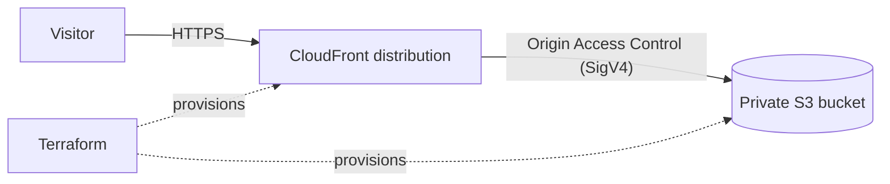
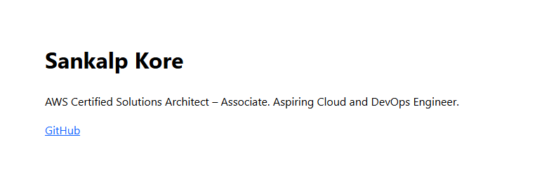
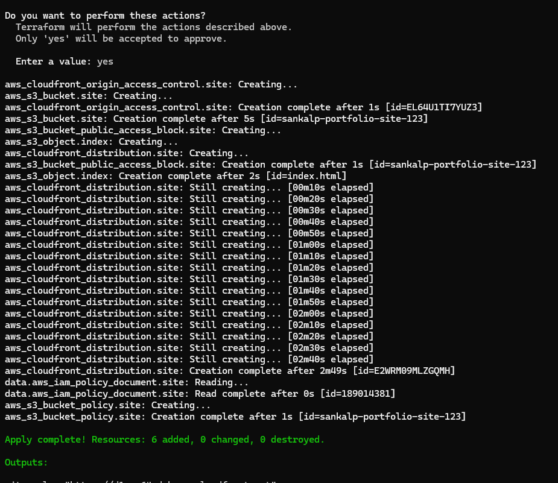
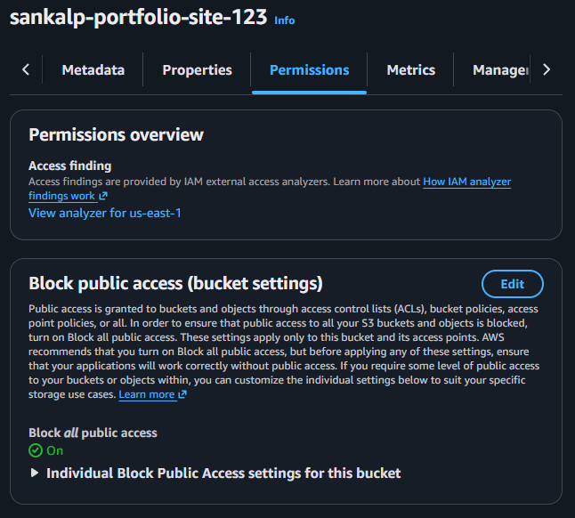

# Static Website on AWS (S3 + CloudFront) with Terraform

A static website hosted on a private S3 bucket and served over HTTPS through CloudFront. The whole stack is defined as code with Terraform, so it can be created, changed and destroyed with a few commands.

## Architecture



## What Terraform creates

Six resources:

1. S3 bucket for the site files
2. S3 public access block (all four settings on)
3. CloudFront Origin Access Control
4. CloudFront distribution (HTTP redirected to HTTPS)
5. S3 bucket policy allowing only that distribution to read objects
6. `index.html` uploaded as an S3 object

## Services used

S3, CloudFront, IAM (bucket policy), Terraform (AWS provider)

## Repository structure

```
.
├── main.tf              # all infrastructure
├── site/
│   └── index.html       # website content
├── docs/                # screenshots
├── .terraform.lock.hcl  # pinned provider versions
└── .gitignore           # keeps state files and local cache out of Git
```

## Design decisions

- **Private bucket with Origin Access Control:** the bucket has no public access at all. The bucket policy only allows `s3:GetObject` from this one CloudFront distribution (matched by its ARN), so the site can only be reached through CloudFront.
- **CloudFront in front of S3:** gives HTTPS, caching at edge locations and a stable URL without exposing the bucket.
- **Managed caching policy:** uses AWS's CachingOptimized policy instead of a custom one, which is simpler and a sensible default for static files.
- **Terraform for everything:** the setup is repeatable and reviewable, and `terraform destroy` removes it cleanly.
- **State kept local and ignored by Git:** state files can contain sensitive values, so `.gitignore` excludes them. See improvements for remote state.

## How to deploy

Requires Terraform and the AWS CLI, with credentials configured via `aws configure`.

```
terraform init
terraform plan
terraform apply
```

`bucket_name` must be globally unique, so change the default in `main.tf` (or pass `-var bucket_name=your-name`). When apply finishes, Terraform prints `site_url`. CloudFront can take a few minutes to finish deploying.

To remove everything:

```
terraform destroy
```

## Output

### Live site


### Terraform apply


### Bucket is private


## Possible improvements

- GitHub Actions pipeline to redeploy on every push
- Remote Terraform state in S3 with locking
- Custom domain with Route 53 and an ACM certificate
- CloudFront cache invalidation after content updates
